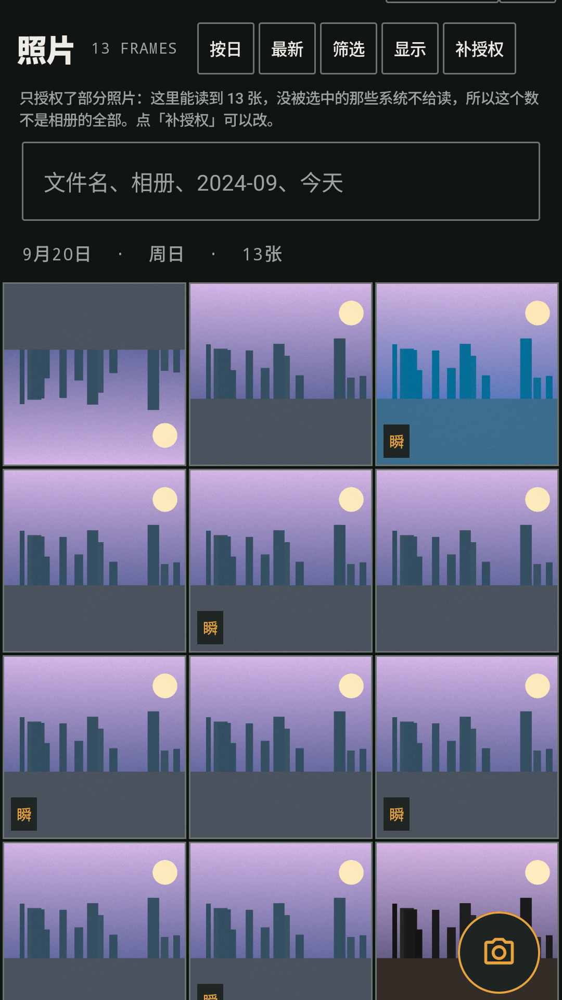
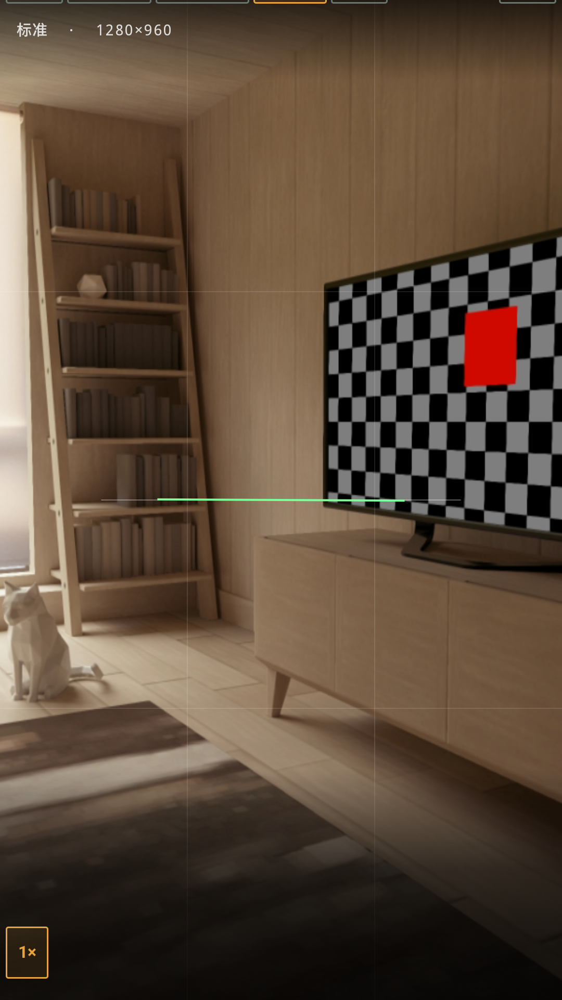
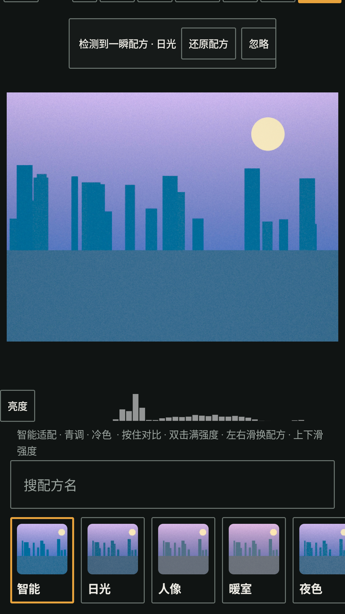
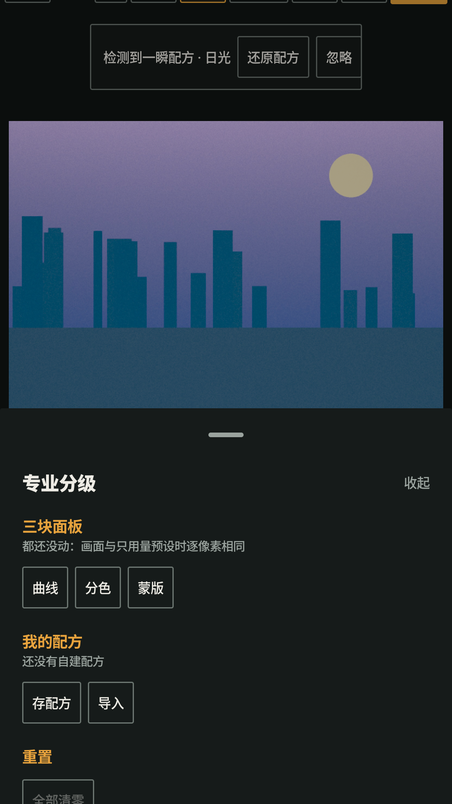

# 随拍 · SuiPai

> **一部「摄影师的暗房接触印样」：相册是主体，相机是入口，一瞬是手艺。**
> 安卓相册 + 内置高像素相机 + 端侧质感调色。画面内容一个像素都不改。

[](#)
[](#技术栈)
[](#技术栈)
[](#构建与测试)

> **公开预览版（Beta）**：Android 代码与 JVM 单测可用，但若干功能尚未完成真机验收；iOS SwiftUI 壳仍需在 Mac 上首次编译。请勿把此仓库视为已通过商店审核的正式稳定版。现有问题与验证状态见 [功能矩阵](docs/feature-matrix.md) 和 [公开版 QA 状态](docs/QA_STATUS.md)。

---

## 这是什么

一个**不修图**的相册。它调的是光影与色彩 —— 影调曲线、分离色调、8 色相分色、局部蒙版、
动态颗粒 —— 而不是磨皮瘦脸。你的脸还是你的脸，只是这一张更有质感。

和「美颜相机」「一键 P 图」的区别只有三条，但每一条都是根本的：

| # | 它不是什么 | 它是什么 |
| :---: | --- | --- |
| 1 | **不是美颜，不是 P 图** —— 不磨皮、不瘦脸、不擦除、不换天，不改画面内容 | 只改**光影与色彩**：白平衡、影调、饱和、颗粒、暗角、分色、局部曝光 |
| 2 | **原图永远保留** —— 每一张成片都是**新文件**，原片原地不动 | 随时能对比原图、换配方、调强度、还原；配方还写进 EXIF 跟着照片走 |
| 3 | **原图不上传** —— 没有账号、没有服务器、没有统计 SDK、没有广告 SDK | 全部处理在端侧；出网只有两件要你亲手发起的事：局域网互通、可选的智能配方 |

### 四张截图

| 相册 · 时间线 | 相机 · 取景 | 一瞬 · 配方 | 一瞬 · 专业调色 |
| :---: | :---: | :---: | :---: |
|  |  |  |  |

> 上图引用仓库当前的 `store/screens/phone/` 预览素材，`store/screens/phone2/` 保留较高分辨率的采样截图。
> **这些是模拟器预览，不等于真实设备的验收证明。** 上架商店之前仍需在实际手机上复测取景、权限、调色导出与互通，并审核每张宣传图是否准确对应当次发布的界面。

---

## 功能矩阵

六组：**看**（浏览）/ **拍**（拍摄）/ **冲**（调色）/ **收**（整理）/ **玩**（创作）/ **控**（设置）。

图例：**✅ 已实现且有验证证据**（JVM 单测，或模拟器上实际出图）；**⚠️ 已实现、待装机验证**；
**❌ 未做**（明确不做，不是遗漏）。

### 看 · 浏览

| 能力 | 状态 |
| --- | :---: |
| 时间线按日 / 周 / 月 / 年分组，滚动时顶部留住当前这一组的日子，点它回到本组开头 | ✅ |
| 双指缩放切换网格密度；右侧年份轨快速跳转 | ⚠️ |
| 多路筛选：日期与时段、方向、画幅、像素、体积、文件名 | ✅ |
| 大图查看器：双指缩放、旋转、16 种裁切比例、15 档导出尺寸、设为壁纸 | ✅ |
| 全库搜索：按日期（`2024-09` / `9月21日`）、相册、收藏、EXIF 相机型号、文件名、自由文字，并给出**命中原因** | ⚠️ |
| 搜索历史（10 条）与建议；结果按 照片 / 相册 / 相机型号 / 年份 分组 | ⚠️ |
| 视频：网格、播放、分享、把当前帧存成照片 | ⚠️ 部分（见下） |

> **视频权限（0.7.1 Beta）**：Android 13+ 的 `READ_MEDIA_VIDEO` 已声明，进入视频页后由用户主动点「授权视频」申请；Android 14+ 支持仅补选部分视频。未授权、部分授权和读库失败不会误报成「没有视频」。这条链路尚需在真实手机上验收。

### 拍 · 拍摄

| 能力 | 状态 |
| --- | :---: |
| CameraX 最大静帧、JPEG 95–100、原字节落盘，能开就开厂商 HDR / 夜景扩展 | ✅ |
| 24 种构图辅助线、10 档画幅一循环、水平仪与水平快门、曝光保持、点按对焦、拖动调 EV | ✅ |
| 延时 2/3/5/10 秒、连拍 3/5/7/9 张与快慢档、间隔拍摄、自拍镜像、前摄屏闪补光 | ✅ |
| 日期水印：四角、三种样式、三档字号、实色或半透 | ✅ |
| **专业模式**：ISO 22 档 / 快门 40 档 / EV ±3 / 白平衡 9 档 / 手动对焦（屈光度档 + 连续滑杆） | ⚠️ 三处调用点断链已修（代码 + JVM 单测），**AVD 与真机都没跑过** |
| 亮度直方图（独立第三路 `ImageAnalysis`，64 桶，采样步长 8） | ⚠️ 降级时那句话现在是三态纯函数；装机未验 |
| 峰值对焦 · RAW/DNG · HDR 包围曝光 · 测光模式 | ❌ |

### 冲 · 调色

| 能力 | 状态 |
| --- | :---: |
| **5446 条**内置配方，按名字搜，也按照片现场选（智能） | ✅ |
| 强度 0–100 连续可调；按住看原图对比，双击满强度，左右滑换配方，上下滑调强度 | ✅ |
| 7 条影调滑杆（色温 / 对比 / 饱和 / 阴影 / 褪色 / 高光 / 柔光）+ 颗粒与暗角两档倍率 | ✅ |
| **专业分级**：曲线（2–16 控制点，Fritsch–Carlson 单调三次 Hermite）、HSL 8 色相带、径向 / 线性局部蒙版（上限 4） | ⚠️ |
| 自定义配方：保存 / 重命名 / 删除 / 导出 `SPLOOK1:` 文本 / 导入 | ⚠️ |
| **配方随照片走**：调色参数写进 EXIF（v3），任何一端打开都能一键还原 | ✅ |
| 智能配方（可选）：大模型看这一张的 256 px 缩略 JPEG，从配方库里挑一条并说明理由 | ✅ 总开关默认关闭 |
| 中性输入走快路径：零偏移 / 恒等曲线 / 零调整蒙版时，输出与旧版**逐字节相同** | ✅ |

### 收 · 整理

| 能力 | 状态 |
| --- | :---: |
| 收藏（星标）/ 隐藏 / 批量删除 / 批量副本 / 批量一瞬 | ✅ |
| **回收站**：删除进 30 天候车室，可恢复、可彻底删除、到期自动清理 | ⚠️ 部分 |
| 收藏夹（用户自建相册，上限 200 个 / 每册 5000 张） | ⚠️ 可建 / 改名 / 删 / 看，也能「加入选中」；装机未验 |
| **重复照片合并**：大小逐字节 + 拍摄时间 ≤120 秒 + dHash ≤6 三键判据，并查集聚类，给出保留建议 | ⚠️ |
| **存储分析**：6 档尺寸堆叠条、按来源分类、最大 20 个文件；只报告不代删 | ⚠️ |

### 玩 · 创作

| 能力 | 状态 |
| --- | :---: |
| **拼图**：12 套模板 + 边框 / 外边距 / 圆角 / 底色 / 画幅 / 导出 2048 或 4096 px，长按拖拽换位 | ⚠️ |
| 胶片边框（35mm 齿孔 / 120 / 拍立得）+ 漏光（4 角、5 档强度；强度 0 时逐像素不变） | ⚠️ |
| **回忆**：某年今天 / 一年前的今天 / 最近一周 / 这个月 / 去年夏天 / 第一次拍的那天 | ⚠️ |
| **幻灯片**：2/3/5/10 秒四档、循环、随机（洗牌袋，取尽一轮才重洗） | ⚠️ |
| 配方卡：把一条配方画成一张可分享的图 | ⚠️ 入口已接（一瞬 › 更多 › 导出），装机未验 |
| 投屏意图：系统能接就交给系统，探测不到就明说 | ⚠️ 入口已接（查看器 › 更多 › 外部打开），装机未验 |

### 控 · 设置

| 能力 | 状态 |
| --- | :---: |
| **设置中心**：8 组（通用 / 外观 / 相册 / 相机 / 一瞬 / 隐私 / 存储 / 关于）+ 顶部搜索 | ✅ |
| 外观：主题（跟随系统 / 暗房 / 日光印样）、字号、网格密度、缩略图质量、减弱动效，带即时预览 | ⚠️ |
| **首启引导**：3 屏，可滑可跳过，末屏接权限；设置里可重看 | ✅ |
| **隐私与数据中心**：数据去向、权限逐项用途、导出「本机数据说明」（JSON）、清除设置 | ⚠️ |
| **导出与恢复**：一份 `.json` 备份（设置 / 配方 / 收藏夹 / 收藏与隐藏 / 搜索历史），两种合并方式 | ⚠️ |
| 桌面小组件「最近的照片」（2×2 / 4×2 自适应）+ 3 条静态快捷方式（拍 / 传 / 改）+ 2 条动态快捷方式（最近一张 / 回收站） | ⚠️ |

**「待装机验证」是什么意思**：代码写完、JVM 单测全绿、编译通过，但**还没有在真机或模拟器上
走完整条用户路径**。这是本仓库最硬的一条纪律 —— 不把「没验」写成「已完成」。
逐条状态与证据见 `docs/feature-matrix.md`，未验证项的清单见 `docs/handoff.md`。

---

## 技术栈

| 层 | 选型 |
| --- | --- |
| 语言 | **Kotlin 2.0.21**（`jvmTarget 17`） |
| Android UI | **Jetpack Compose**（BOM 2024.12.01，Material 3 1.3.1） |
| 相机 | **CameraX 1.4.1**（core / camera2 / lifecycle / view / extensions） |
| 图片 | Coil 2.7.0 + 一层自定义 `Fetcher`，直接走系统 MediaStore 缩略图 |
| 存储 | MediaStore（照片）、SharedPreferences（偏好）、`filesDir` 下的手写 JSON（回收站 / 索引 / 收藏夹 / 配方） |
| 加密 | AndroidKeyStore 里不可导出的 AES-256-GCM 主密钥（只用于 API Key） |
| 跨端 | **Kotlin Multiplatform**：调色引擎 / 5446 条预设 / 场景识别 / 互通协议，**双端共享同一份代码** |
| iOS 壳 | SwiftUI + AVFoundation，引用 `SuiPaiKit` 共享框架（**尚未在 Mac 上编译验证**） |
| SDK | `minSdk 26`（Android 8.0）／`targetSdk 36`（Android 16）／`compileSdk 36` |
| 构建 | AGP 8.9.2 + Gradle 8.11.1；R8 + 资源压缩出 release 包 |

依赖只有 androidx、JetBrains Kotlin、Coil、kotlinx-coroutines / serialization。
**没有统计 SDK、没有广告 SDK、没有崩溃回传、没有第三方网络栈** —— 出网用 Android 自带的
`HttpsURLConnection`。这条不是口号：`AiGuardTest` 用源码级断言钉着「出网代码只许一处」。

---

## 架构

```
┌───────────────────────────────────────────────────────────────────────┐
│  ① UI 层 · app/src/main/java/com/suipai/app/ui/                       │
│     各屏 Composable：只画 + 转发回调，不持有仓库、不导航               │
│     design/ 设计系统 · common/ 工具条与弹层 · camera/ viewer/ yishun/  │
│     gallery/ settings/ trash/ search/ collage/ memories/ slideshow/    │
│     tools/ video/ play/ onboarding/ privacy/ widget/                   │
├───────────────────────────────────────────────────────────────────────┤
│  ② 状态层 · state/ + nav/ + settings/                                 │
│     AppRoute（目的地 + 编码）· BackStack（可保存的返回栈）             │
│     NavPolicy（返回键优先级，纯函数）· AppState（照片 / 选择 / 批量）   │
│     BatchActions / DeleteFlow / ShareImport · settings/（设置键与落盘） │
│     ↕  nav/AppNavHost · NavRender · AppChrome 只做接线，不含业务规则    │
├───────────────────────────────────────────────────────────────────────┤
│  ③ 引擎层 · shared/（Kotlin Multiplatform，Android 与 iOS 同一份）      │
│     engine/ ColorCore（色彩管线）· ToneCurve · HslBands · LocalMask    │
│     engine/ LookLibrary（5446 条预设）· SceneAnalyzerCore              │
│     ai/ 端点表与建议解析 · sync/ FrameCodec · SyncProtocol             │
│     commonMain ─ 双端共享；androidMain ─ java.net；iosMain ─ posix     │
└───────────────────────────────────────────────────────────────────────┘
        app  ──implementation(project(":shared"))──►  shared
```

**两条硬边界**：

1. `state/` 里除 `NavState` / `AppState` / `ChromeState` 之外全是纯 Kotlin
   （不 import Compose、不 import Android），所以能被 JVM 单测直接钉住；
2. `nav/` 只做接线。**新加一个屏幕不需要改 `MainActivity`** —— 加一个 `AppRoute`、
   一个 `when` 分支、一条往返用例即可（模板见 `docs/arch/APP-ARCH.md` §六）。

`MainActivity.kt` 现在只做 7 件事（生命周期 / `setContent` / 权限门 / 建 `AppState` /
两个 `ActivityResultLauncher` / 系统栏 / intent 收集），从 1172 行降到 **298 行**
（2026-10-29 `SelectionState` 接线后是 **313 行**，仍然是那 7 件事）。

### 调色管线分层

```
sRGB 编码像素
   │
   ├─ 线性化 → 主循环（白平衡 / 影调 / 分离色调 / 饱和 / 褪色 / 暗角 / 颗粒）
   │            ← 行带切分，可并行，无邻域依赖
   │
   └─ 量化后再卷一次：
        局部蒙版（权重场，按行预计算，无边界 halo）
      → HSL 分色（WEIGHT_LUT[360×8]，热循环只剩数组读）
      → 曲线（3 × 256 项烘焙表，每通道 1 次数组读，不是 pow）
```

三个专业算子都在**量化之后**（显示域）：用户是对着屏幕拖它们的。
中性输入时三段一次都不进 —— 升级不会改掉你之前的调色结果，
由 `shared` 的 `ProPipelineIdentityTest` 用 64×64 图逐字节钉死。

实测（JVM，4096×3000 = 12.29 MPix，单线程）：v2 基线 1302 ms → 三者全开 2382 ms；
8 线程行带折算约 **300 ms**。详见 `docs/engine/COLOR-PRO.md`。

---

## 构建与测试

> **本仓库禁止直接 `gradlew`**：多个 agent 会在同一工作区并行构建，裸 gradle 会抢锁、
> 各起一个 daemon 打爆内存（本机 14.3 GB）。所有构建一律走串行闸。

```powershell
# 编译（只跑 Kotlin 编译，最快的一档）
pwsh tools/abuild.ps1 :app:compileDebugKotlin

# 全部 JVM 单测（app + shared）
pwsh tools/abuild.ps1 :app:testDebugUnitTest :shared:testDebugUnitTest

# 只跑某一族
pwsh tools/abuild.ps1 :app:testDebugUnitTest --tests "com.suipai.app.settings.*"
```

`tools/abuild.ps1` 用文件锁（`C:\tmp\suipai-build.lock`）把构建串成一队，45 分钟未更新的锁
视为僵尸锁自动清理；日志落 `C:\tmp\build-<pid>-<hhmmss>.log`，失败时回显末尾 120 行，
并返回 gradle 的退出码。

### 设备

```powershell
pwsh tools/emu.ps1 start      # 起/复用模拟器（默认 AVD: suipai_gapi），stdout 最后一行是 serial
pwsh tools/emu.ps1 status     # 现在有没有在跑、是哪台
pwsh tools/emu.ps1 stop       # 关掉（收尾必做）
```

```powershell
pwsh tools/verify.ps1 install    # 装最新 debug APK + md5 认包
pwsh tools/verify.ps1 smoke      # 冷启动 + 逐屏锚文本断言
pwsh tools/verify.ps1 dump       # 打印当前屏语义树（已去噪）
pwsh tools/verify.ps1 shot 03-相机   # 截图落 store/screens/phone/
pwsh tools/verify.ps1 log        # 只看 FATAL / ANR
pwsh tools/verify.ps1 report     # 汇总本轮跑到哪一步
pwsh tools/verify.ps1 cleanup    # 收尾：杀 logcat/instrument + 关我们自己的模拟器
```

```powershell
# 截图归一化：1080×2400 → 居中裁到 9:16 并缩到 1080×1920（不是拉伸）
pwsh tools/shots.ps1 -In store/screens/phone2 -Out store/screens/phone
```

⚠️ 本机只有 14.3 GB 可用内存，**同一时刻只允许一台模拟器**，用完必须 `stop`；
**绝不要 `adb kill-server`**（这台机器上还有别的会话共用同一个 adb server）。
人眼判据的检查单在 `docs/arch/DEVICE-CHECK.md`，设备侧自验的账在 `ANDROID-VERIFY.md`。

### 环境

```powershell
$env:JAVA_HOME    = 'C:\Program Files\Microsoft\jdk-17.0.20.101-hotspot'
$env:ANDROID_HOME = "$env:LOCALAPPDATA\Android\Sdk"
```

JDK **17**（不是 21）。KMP 的 `iosArm64` / `iosSimulatorArm64` target 在 Windows 上被禁用
（`kotlin.native.ignoreDisabledTargets=true`），这是**正常的**，不是错误。

### 当前构建与产物（本机实测）

> **条数是移动靶。** 下面每个数字都带测量时间；`build/` 被清过就得重跑。
> 量不到就说量不到 —— 这一节没有"大概"和"应该"。

| 项 | 值 |
| --- | --- |
| `:app:testDebugUnitTest` | **784 条 / 61 个 result XML / 0 失败 / 0 跳过**（2026-10-29 实测，产物在 `app/build/test-results/testDebugUnitTest`）。<br>本轮开工时的基线是 **881（app+shared 合计）/ 73 个 XML**（开工那批 XML 已被重跑覆盖）；收工实测 784 + 135 = **919**。<br>历史快照：2026-10-18 14:47 是 725 条 / 57 个类，**不要再引用它当当前值** |
| `:shared:testDebugUnitTest` | **135 条 / 16 个 result XML / 0 失败**（2026-10-29） |
| `:app:androidTest` | **69 个 `@Test` / 14 个文件**（**只验证过能编译**，没有跑过仪器化） |
| release APK | **3.48 MB**（3,645,239 B）—— **0.7.0 那次构建的数，本轮没重新打包**。<br>⚠️ 2026-10-29 复核：磁盘上 `app/build/outputs/apk/release/app-release.apk` 实际是 **3,722,008 B**（mtime 2026-10-18 15:59，`output-metadata.json` 里 `versionCode 7`）。两个数都是"0.7.0"，但对不上；**哪个才是发出去的那个，我判断不了，所以两个都留着** |
| release AAB | **6.93 MB**（7,262,827 B）—— 同上。<br>⚠️ 磁盘上 `app/build/outputs/bundle/release/app-release.aab` 实际是 **7,416,908 B**（同一时刻），也对不上 |
| lint（release） | **0 error**；留存报告里有 5 条 warning（2 条 `DefaultLocale` 已在源码用 `Locale.ROOT` 修掉，报告未重跑） |
| 版本 | `versionCode 7` / `versionName "0.7.0"`（本轮没有改版本号） |

> 以上是**本机实测**。没量过的不写：仪器化测试、真机相机能力、iOS 编译、Android 16 行为
> 全部标为未验证，清单见 `docs/handoff.md` §7。
> **2026-10-29 那一轮（设置键统一 / 三处入口 / 三条技术债 / 相机专业模式 / 互通翻页）
> 一次装机都没做、也没有重新打包** —— 它的作业单在 `ANDROID-VERIFY.md` §45.2。

---

## 目录结构

```
SuiPai/
├── app/                          Android 应用模块
│   ├── src/main/java/com/suipai/app/
│   │   ├── MainActivity.kt       入口（313 行，只做 7 件事）
│   │   ├── state/                路由 / 返回栈 / AppState / 批量 / 删除授权链（纯 Kotlin）
│   │   ├── nav/                  AppNavHost / NavRender / AppChrome（接线层）
│   │   ├── settings/             设置键 / 落盘 / 目录模型 / 引导闸门
│   │   ├── data/                 MediaStore / 回收站 / 搜索索引 / 收藏夹 / 配方 / 备份 / 视频
│   │   ├── engine/               色彩管线平台侧、AI 适配、场景分析
│   │   ├── ui/                   各屏 Composable（22 个包 / 69 个文件）
│   │   └── widget/               桌面小组件与快捷方式
│   ├── src/test/                 JVM 单测（57 个 .kt / 784 条，2026-10-29 实测）
│   └── src/androidTest/          仪器化测试（14 个文件 / 69 个 @Test，未跑过）
├── shared/                       KMP 共享层（161 个 Kotlin 文件）
│   └── src/
│       ├── commonMain/           引擎 / 预设 / AI 协议 / 互通协议（双端同一份）
│       ├── androidMain/          java.net socket
│       ├── iosMain/              platform.posix socket（待 Mac 验证）
│       └── commonTest/           shared 单测（16 个 .kt / 135 条）
├── ios/                          SwiftUI 壳 + BUILD.md / FEATURE-GAP.md（未编译）
├── docs/                         架构 / 设计 / 引擎 / 产品 / 审计 / 交接
├── store/                        上架材料：文案 / 政策 / 截图 / 图标
├── tools/                        abuild / emu / verify / shots 四把闸
├── GOAL.md                       长期目标与阶段
├── PRODUCT.md                    产品上下文
├── SYNC.md                       局域网互通协议
├── ANDROID-VERIFY.md             设备验证账本（2700+ 行，最详细的现场记录）
└── CHANGELOG.md                  面向用户的版本历史
```

---

## 设计语言

**暗房接触印样（contact sheet）**：相片是相纸，界面是印样页的框线与编号。
深灰绿暗房底 `#101413`（不是纯黑）、相纸白字 `#EDEBE4`、**琥珀 safelight `#E8A33D`
是全应用唯一强调色**、近直角 2 dp 圆角、编号一律等宽；浅色主题「日光印样」是独立的纸白配色，
不是简单反色。

一条规则定义了全部层级：**一屏只允许一个琥珀实心块**（主操作）。其余一切都只有描边 ——
于是「该按哪一颗」不需要读字。危险操作走定影红 `#C4453B`，且只出现在删除 / 清空 / 覆盖。

完整 token、字级、间距、动效刻度与禁止用法见
[docs/design/DESIGN-SYSTEM.md](docs/design/DESIGN-SYSTEM.md)。

---

## 已知限制

诚实清单，完整版见 [docs/handoff.md](docs/handoff.md) §7：

- **多数新功能标「待装机验证」**：设置中心、引导、隐私中心、回收站、收藏夹、搜索、拼图、
  回忆、幻灯片、专业调色、专业相机、重复照片、存储分析、视频、导出与恢复。
  代码与 JVM 单测都过了，但没有在真机/模拟器上走完整条用户路径。
- **iOS 壳一次都没编译过**：Windows 上编不了 Kotlin/Native。首次上 Mac 要预留微调时间。
- **没有 `READ_MEDIA_VIDEO`**：Android 13+ 的视频页只能看到随拍自己写入的行。
- **外来照片不能进回收站**：只有随拍写入 `Pictures/SuiPai` 的行才搬得动；
  对相机/截图/微信的图点删除，会走系统授权框或明说「这张不是随拍拍的」。
- **回收站恢复后的拍摄时间**：`TrashItem.dateTaken` 会把原始 `DATE_TAKEN` 带回去
  （老账单缺这个键时解成 0 = 不知道，行为与从前一致）。**代码完成，装机未验**。
- **旧设置键已统一（代码完成，装机未验）**：`cfg_` 是**真源**，老键降级为只写不读的兼容写
  （`settings/SettingsBridge.kt` 是唯一的桥）；绝大多数设置项已是 `LIVE`，
  **仍剩三项 PENDING**（年份索引 / 桌面拍照快捷方式 / 缓存过大提醒），那三行在设置页灰着并写「等接线」。
- **`AppState.selectedIds` 已进 Saver**（`state/SelectionState.kt`，上限 5000，超限整体不存）。
  进程被杀后重建选择还在；**分屏/进程重建的装机验证没做**。
- **同步收照片会丢拍摄时间**：`MediaRepository.saveJpeg` 还不接受 `dateTaken`，
  收到的照片按「收到的先后」落时间戳 —— **时间线顺序会乱**。修法与影响见 `docs/handoff.md`。
- **预测式返回未接线**；edge-to-edge 只在相机 / 查看器 / 一瞬生效；
  分屏与折叠屏换外屏未在真机上量过。
- **配方卡 / 投屏 / 收藏夹「加入选中」三处入口已接（代码完成，装机未验）**：
  一瞬 › 更多 › 导出 › 配方卡；查看器 › 更多 › 外部打开 › 投屏；收藏夹页的「加入选中」。
- **商店截图仍是 0.6.0 的模拟器合成场景**，上架前需整组重拍。

---

## 文档地图

| 想看什么 | 去哪 |
| --- | --- |
| 长期目标与阶段 | [GOAL.md](GOAL.md) |
| 产品定位、受众、不可妥协的原则 | [PRODUCT.md](PRODUCT.md) |
| 应用架构、状态所有权表、新屏接入 5 步 | [docs/arch/APP-ARCH.md](docs/arch/APP-ARCH.md) |
| 设计 token 与组件层级 | [docs/design/DESIGN-SYSTEM.md](docs/design/DESIGN-SYSTEM.md) |
| 专业算子的数学定义与性能预算 | [docs/engine/COLOR-PRO.md](docs/engine/COLOR-PRO.md) |
| 设置项语义 / 默认值 / 落盘键 | [docs/product/SETTINGS.md](docs/product/SETTINGS.md) |
| 搜索索引字段与查询语义 | [docs/product/SEARCH.md](docs/product/SEARCH.md) |
| 拼图 / 回忆 / 幻灯片 / 配方卡 / 投屏 | [docs/product/PLAY.md](docs/product/PLAY.md) |
| 回收站与收藏夹 | [docs/product/TRASH-COLLECTIONS.md](docs/product/TRASH-COLLECTIONS.md) |
| 曲线 / HSL / 局部蒙版的界面接线 | [docs/product/PRO-EDITING.md](docs/product/PRO-EDITING.md) |
| 相机专业模式、档位表与降级矩阵 | [docs/product/CAMERA-PRO.md](docs/product/CAMERA-PRO.md) |
| 重复照片合并 / 存储分析 | [docs/product/TOOLS.md](docs/product/TOOLS.md) |
| 导出与恢复（备份文件） | [docs/product/BACKUP.md](docs/product/BACKUP.md) |
| 视频（只播不编） | [docs/product/VIDEO.md](docs/product/VIDEO.md) |
| 功能 × 状态 × 代码位置 × 测试覆盖 | [docs/feature-matrix.md](docs/feature-matrix.md) |
| 交接：构建、守卫清单、10 条坑 | [docs/handoff.md](docs/handoff.md) |
| 发布流程、签名、R8、lint | [docs/arch/RELEASE.md](docs/arch/RELEASE.md) |
| 装机检查单（给人走的） | [docs/arch/DEVICE-CHECK.md](docs/arch/DEVICE-CHECK.md) |
| 互通协议 | [SYNC.md](SYNC.md) |
| 商店文案 / 发布说明 / 隐私政策 | [store/](store/) |
| 媒体一页纸 | [docs/press-kit.md](docs/press-kit.md) |

---

## 许可

本仓库目前**未声明开源许可**（自有代码，保留所有权利）。

### 第三方组件

| 组件 | 许可 |
| --- | --- |
| Jetpack Compose · CameraX · Material 3 · ExifInterface · Lifecycle | Apache License 2.0 |
| Kotlin · kotlinx-coroutines · kotlinx-serialization | Apache License 2.0 |
| Coil | Apache License 2.0 |

这些组件**不引入任何数据收集行为**。

### 致谢

- **5446 条预设**由本项目自行编写，不使用徕卡商标、机型名或任何厂牌的官方 Look 名称。
- 曲线插值采用 **Fritsch–Carlson 单调三次 Hermite 插值**（1980），是公开的数值方法。
- HSL 带间权重用 smoothstep 交叠而非 `cos`，是为了两端逐位一致（见 `docs/engine/COLOR-PRO.md` §6）。
- 色彩管线设计参考了 AOSP 的 `ImageResizer` 与公开的胶片色彩科学文献。
- 图标、主图与截图全部由项目自绘 / 自拍。

---

**拍完就忘的相机，不该顺手记住别的。**
