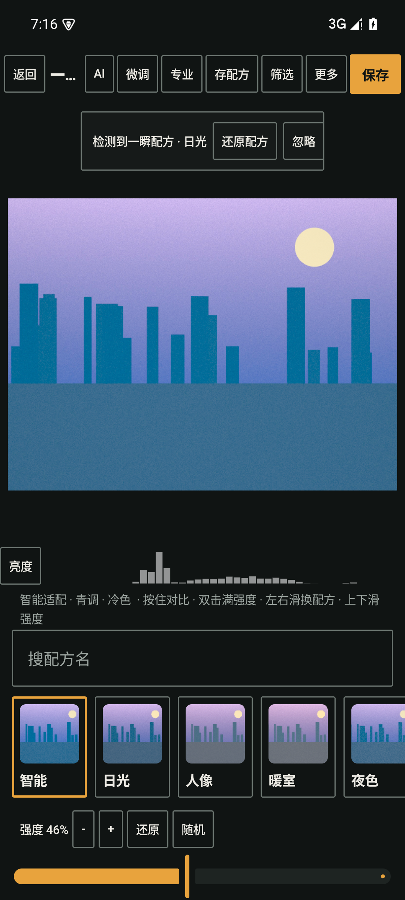
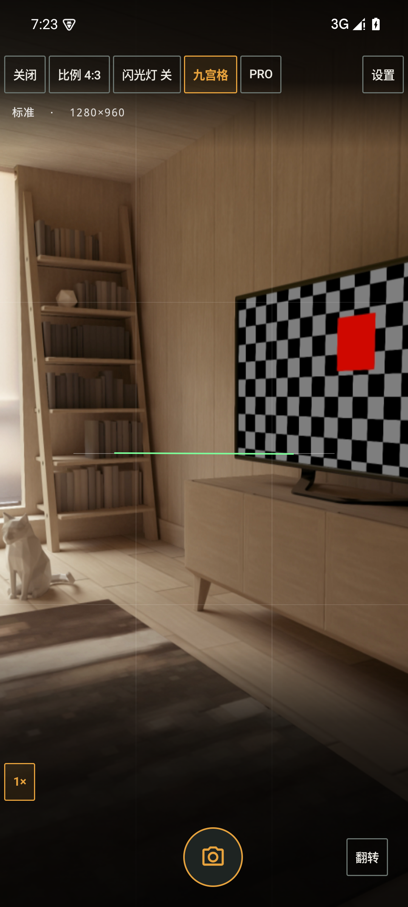
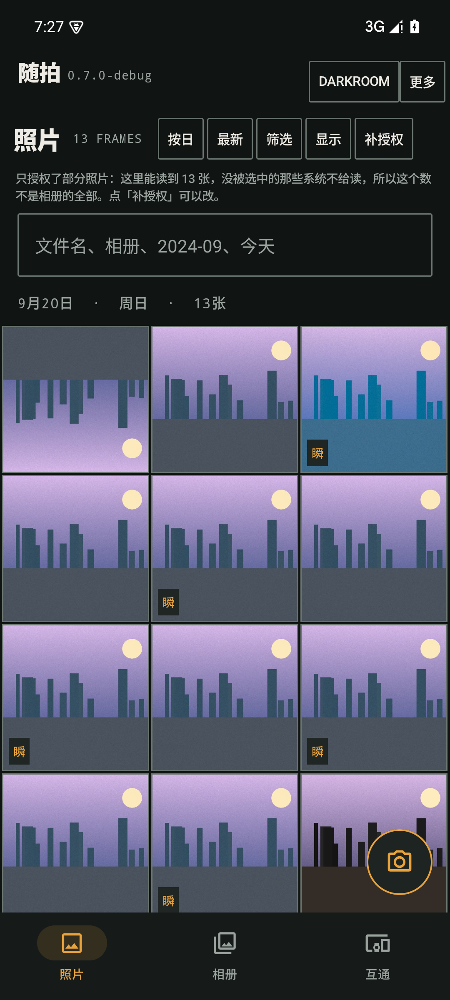

# 随拍 · 媒体资料页（Press Kit）

> 给编辑、评测与推荐位作者的一页纸。所有数字都能追到代码或本机实测，
> 不能追到的都标了「未验证」。
>
> 版本 **0.7.0（versionCode 7）** ｜ 平台 Android 8.0+（API 26+）｜ 包名 `com.suipai.app`
> 最后更新 2026-10-18

---

## 一、三档产品介绍（按需取用）

> 每档后面标的是**实测字符数**。三档都是可以直接贴进稿子的成品，不需要再删改。
> 「含换行」= 保留段落断行时的计数；「不含换行」= 排成一段时的计数。

### 50 字档（65 字符 / 不含换行 64）

> 随拍是一部**不修图**的安卓相册：5446 条胶片配方只调光影与色彩、不改画面内容，
> 原图永远保留、绝不上传，另配一台能手动控制的相机。

### 100 字档（141 字符 / 不含换行 138）
> 随拍把相册做成一张暗房接触印样：照片是相纸，界面是框线与编号。
> 它不做美颜、不做「一键 P 图」—— 只调光影与色彩：影调曲线、8 色相分色、
> 局部蒙版、动态颗粒。5446 条内置配方可一键套用，强度可调，配方写进照片 EXIF 跟着走；
> 原图永远保留在新文件旁边，绝不上传服务器。

### 300 字档（491 字符 / 不含换行 475）

> **随拍**是一部为「拍得多、但不想修图」的人做的安卓相册。
>
> 它的第一条原则是**不改画面内容**。不磨皮、不瘦脸、不擦除、不换天 —— 它调的是
> 光影与色彩：白平衡、影调曲线、分离色调、8 色相分色、局部径向 / 线性蒙版、动态颗粒。
> 你的脸还是你的脸，只是这一张更有质感。
>
> 第二条是**原图永远保留**。每次「一瞬」都产出一份新文件，原片原地不动，
> 随时可以对比、换配方、调强度、还原；调色参数还会写进照片 EXIF，跟着文件走，
> 换一台设备打开也能一键还原。
>
> 第三条是**原图不上传**。没有账号、没有服务器、没有广告与统计 SDK，全部处理在端侧完成。
> 出网的只有两件事，且都要用户亲手发起：同一 WiFi 下的局域网直传，
> 以及可选的「智能配方」（默认关闭，需自填 Key，只发送当前这张照片 256 像素的缩略图）。
>
> 除相册外，它还有一台内置相机（CameraX 最大静帧、24 种构图辅助线、10 档画幅，
> 外加 ISO / 快门 / EV / 白平衡 / 手动对焦的专业模式与亮度直方图），
> 以及拼图（12 套模板 + 胶片边框 + 漏光）、回忆、幻灯片、重复照片合并、存储分析等整理工具。

---

## 二、五条一句话卖点

1. **不修图，只调光。** 不改画面内容 —— 没有磨皮、没有瘦脸、没有擦除，只有影调与色彩。
2. **原图永远保留。** 每一张成片都是新文件；原片、配方、强度随时可回退，可对比。
3. **绝不上传。** 没有账号、没有服务器、没有统计 SDK；5446 条配方全在本机跑。
4. **配方随照片走。** 调色参数写进 EXIF，换一台设备打开同一张照片也能一键还原。
5. **是一台真的相机，不只是滤镜。** 24 种辅助线、10 档画幅、水平仪，加上专业模式的手动曝光。

---

## 三、三张最有代表性的截图

> 图片路径为仓库内路径。`store/screens/phone/` 这一组是 1080×1920（Play 的 9:16 口径），
> **内容仍是 0.6.0 的模拟器合成场景**；0.7.0 的原图在 `store/screens/phone2/`（1080×2400，未裁切），
> 上架前会由 `tools/shots.ps1` 统一裁切并替换。

### 1. 一瞬 · 配方行

> **Caption**：一瞬是一条可以左右滑的配方行 —— 5446 条胶片配方，选中即出片，
> 强度连续可调；按住画面看原图，松手回到成片。

### 2. 相机 · 取景

> **Caption**：内置相机走 CameraX 最大静帧、JPEG 95–100、原字节落盘；
> 24 种构图辅助线、10 档画幅、水平仪与水平快门都在取景框里，右上角那颗 `PRO` 进专业模式。

### 3. 相册 · 接触印样网格

> **Caption**：相册按日分组，每一组上方是一条日期横带，帧数与参数用等宽编号 ——
> 界面是印样页，照片才是主角。

> 备用素材（同样在 `phone2/`）：`01-onboarding`（首启引导）、`08-yishun-pro`（专业分级抽屉）、
> `03-more-drawer`（更多抽屉）、`04-settings`（设置中心）、`10-privacy`（隐私与数据）、
> `06-trash`（回收站空态）。
> `store/screens/phone/` 那一组 1080×1920 的旧图暂时也还在，但内容是 0.6.0 的，**不要用于新稿**。

---

## 四、团队与技术背景

随拍是一个**小团队的自有项目**，中文优先，代码与文案由同一批人写。
产品定位来自一句话：*「拍完就忘的相机，不该顺手记住别的。」*

技术上它是一个 **Kotlin Multiplatform** 工程：调色引擎、5446 条预设、场景识别与
局域网互通协议全部写在 `shared/` 的 `commonMain` 里，Android 与 iOS 引用同一份代码；
Android 侧是 Jetpack Compose + CameraX，iOS 侧是 SwiftUI + AVFoundation（**iOS 壳尚未编译验证**）。

调色不是「接一个修图 API」：它是一条端侧色彩科学管线 —— sRGB 域的主循环做影调与色彩，
量化之后再卷一次局部蒙版 → HSL 分色 → 曲线（256 项烘焙表）。三个专业算子全部是
逐像素、无状态、无邻域的点运算，所以能按行带并行，也能在两端逐位一致。
实测 4096×3000（12.29 MPix）三者全开，单线程 2382 ms，8 线程折算约 300 ms。

工程纪律上有一条被写进仓库根目录的硬规则：**量不到就说量不到，不把「没验证」写成「已完成」**。
所以这份资料里凡是标「未验证」的，都是真的没量过 —— 包括 iOS 编译、真机相机能力、
仪器化测试与 Android 16 的行为。

**当前规模**：release APK 3.48 MB、AAB 6.93 MB；JVM 单测 725 条全绿（57 个测试类，
2026-10-18 14:47 快照 —— 之后仓库里又加了两个测试文件，引用前请重跑一次刷新）。

---

## 五、联系方式

| 用途 | 联系方式 |
| --- | --- |
| 媒体与评测 | `<PRESS_EMAIL_PLACEHOLDER>` |
| 用户支持 | `<SUPPORT_EMAIL_PLACEHOLDER>` |
| 开发者 | 随拍（SuiPai）开发团队 |
| 隐私政策 | `<PRIVACY_POLICY_URL_PLACEHOLDER>`（正文见 `store/privacy-policy.html`） |
| 项目仓库 | `<REPO_URL_PLACEHOLDER>` |
| 应用商店 | `<PLAY_STORE_URL_PLACEHOLDER>`（上架后填） |

> ⚠ 以上五个占位符在对外发布前必须替换成真实信息。
> Play Console 要求隐私政策里有一个能联系到开发者的方式（邮箱即可）。

---

## 六、可用的素材清单

| 素材 | 位置 | 规格 |
| --- | --- | --- |
| 应用图标 | `store/icon-512.png` | 512×512 PNG |
| 商店主图 | `store/feature-graphic-1024x500.png` | 1024×500 PNG |
| 手机截图（已裁切，8 张） | `store/screens/phone/` | 1080×1920 PNG（**0.6.0 旧图，待替换**） |
| 手机截图（0.7.0 原图，14 张） | `store/screens/phone2/` | 1080×2400 PNG，**未裁切、未挑选** |
| 品牌色 | 暗房底 `#101413`、相纸白 `#EDEBE4`、琥珀 `#E8A33D` | — |

> 截图里出现的照片是模拟器上的合成测试场景，不是真实摄影作品，
> 也不含任何第三方版权素材。图标、主图与截图全部由项目自绘 / 自拍。
